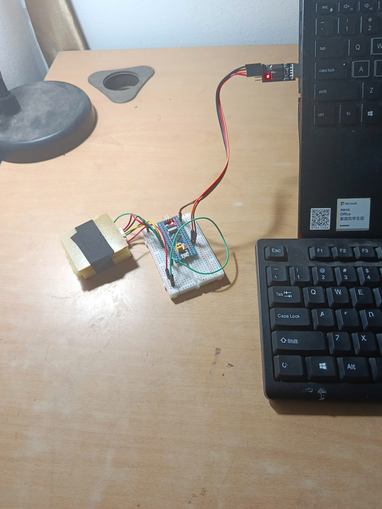
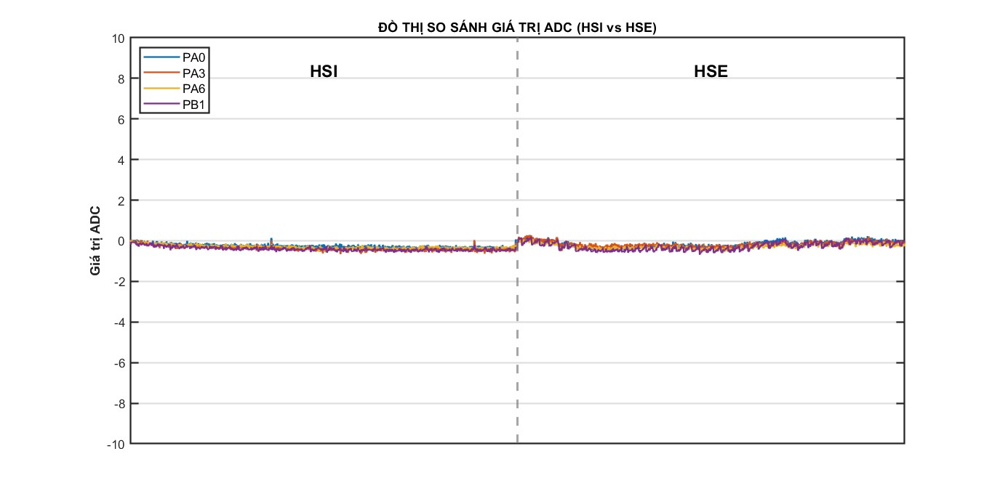
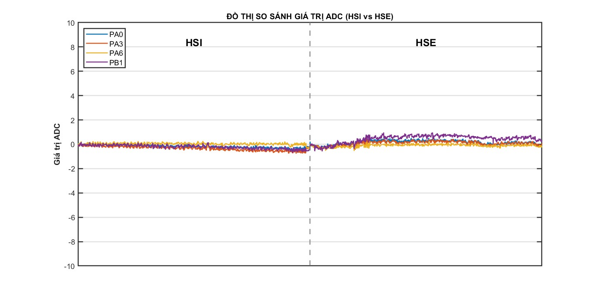
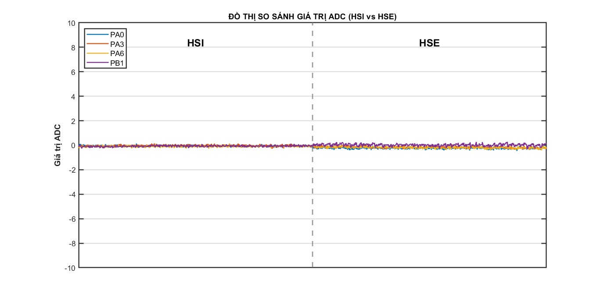
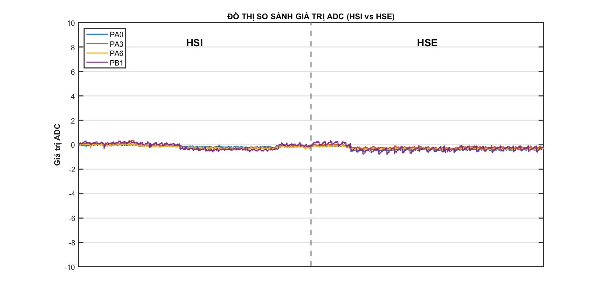
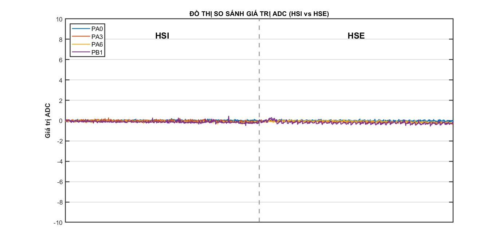
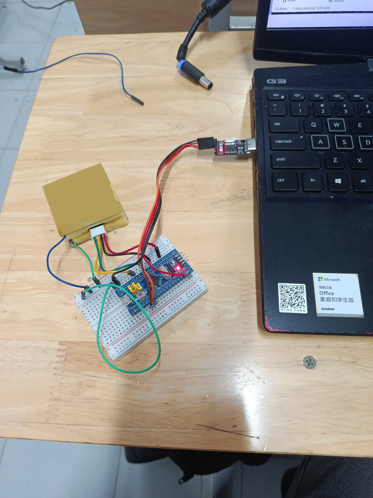
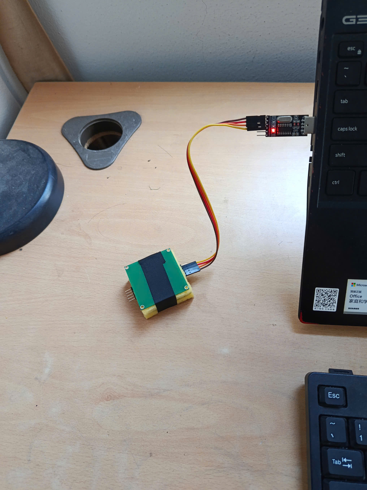
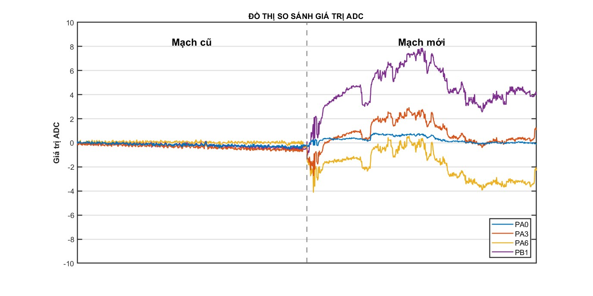

# Báo cáo tiến độ nghiên cứu ngày 17/10/2026
## A. Công việc đã làm
- Loại bỏ code dư thừa
- Đồ thị HSE và HSI khi không tác động mạch cũ
- Đồ thị HSI mạch cũ và mới
## B. Khó Khăn
## C. Báo cáo chi tiết 
### 1. Code sau rút gọn

### 2. Đồ thị HSI và HSE khi không tác động mạch cũ
- HSI có thời gian đo là 79.92ms
- HSE có thời gian đo là 80ms
- Lúc đo rút sạc máy tính và bỏ dây dư thừa
- Hình ảnh khi đo

- Tiến hành đo 5 lần
#### Lần 1

##### Nhận xét
- Giá trị 4 chân đo HSI mượt 
- Giá trị 4 chân đo HSE xuất hiện sóng răng cưa

#### Lần 2

##### Nhận xét:
- Lúc đo HSI giá trị đo các chân bị tách nhau ít
- Lúc đo HSE giá trị đo các chân bị tách nhau khá nhiều và không ổn định

#### Lần 3

##### Nhận xét:
- Giá trị lúc đo HSI và HSE đẹp

#### Lần 4

##### Nhận xét
- Giá trị lúc đo HSI đẹp, có những đoạn bị trôi giá trị
- Giá trị lúc đo HSE xuất hiện nhiều sóng răng cưa

#### Lần 5

##### Nhận xét
- Giá trị lúc đo HSI và HSE khá đẹp

### 3. Đồ thị HSI xấu mạch mới với đẹp mạch cũ
#### Hình ảnh lúc đo
##### Mạch cũ

##### Mạch mới

##### Hình ảnh so sánh giá trị xấu nhất mạch mới và đẹp nhất mạch cũ

